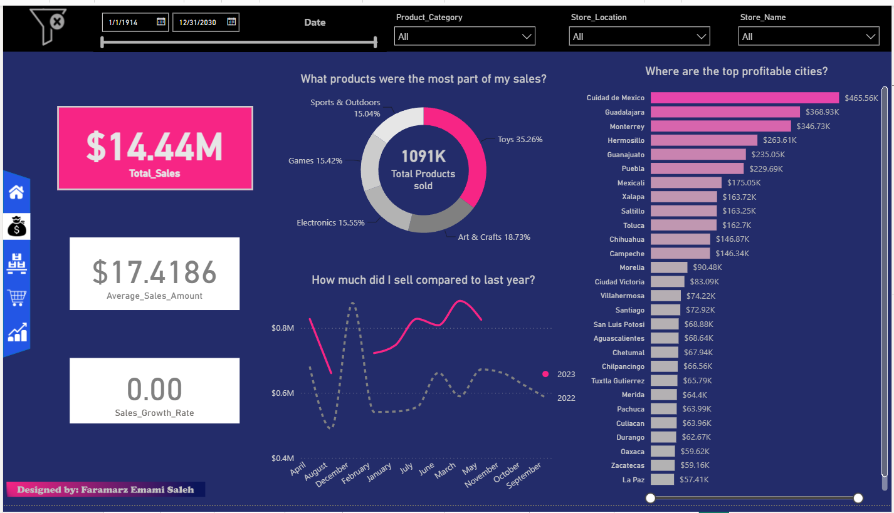
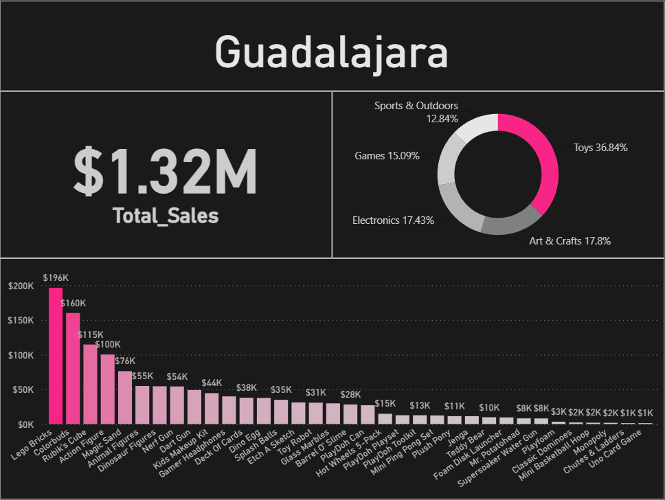
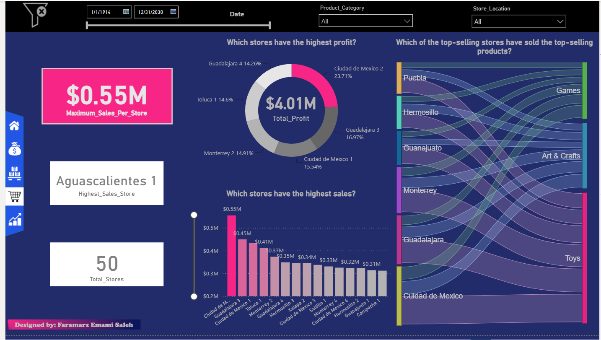
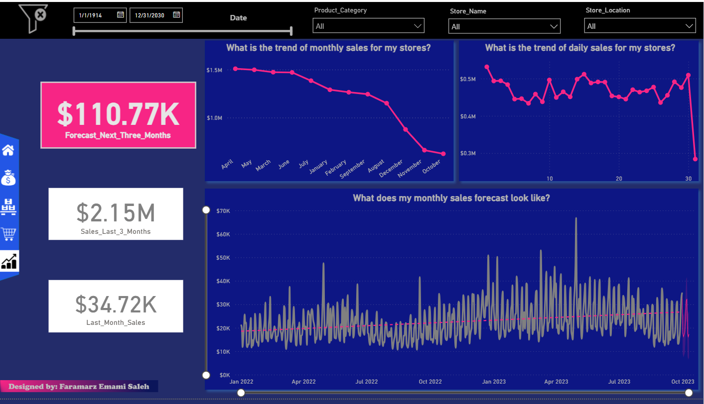
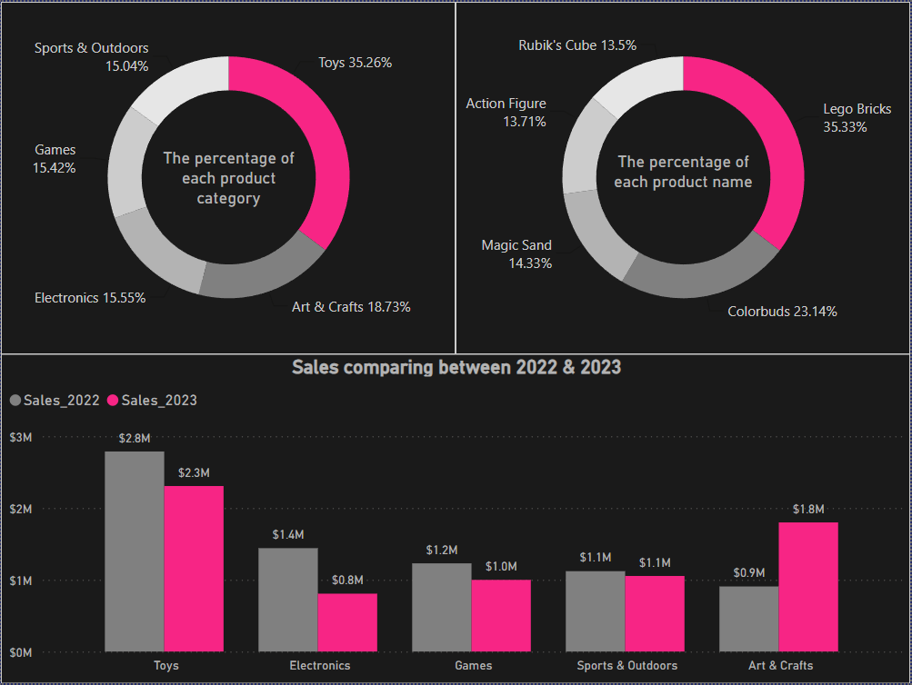

# Sales & Inventory Management Analytics — Power BI

Final project for a Power BI course at the University of Tehran.
Interactive report covering sales, inventory, store performance and sales forecasting
for a toy retail chain.

> **Data:** Course-provided dataset (appears to be based on the Maven Toys sample dataset).
> Not real company data.

## Report pages
| Page | What it answers |
|---|---|
| Home | Navigation and report overview |
| Sales | Total sales, sales by category, year-over-year comparison, most profitable cities |
| Inventory | Stock value by product, category share of inventory, stock turnover, low-stock products |
| Stores | Highest-profit and highest-sales stores, top stores vs. top product categories (Sankey) |
| Forecast & Trend | Monthly and daily sales trends, 3-month sales forecast |
| Drill-through & tooltips | City-level drill-through; tooltips for store and product breakdowns |

## Tools
Power BI · DAX · Data modeling

## Screenshots
### Sales

### City drill-through

### Stores

### Forecast & Trend

### Sales tooltip

## Contact
Faramarz Emamisaleh — Nantes, France · faramarz.emami.saleh@gmail.com · [LinkedIn](https://www.linkedin.com/in/faramarz-emamisaleh-229128b9/)
